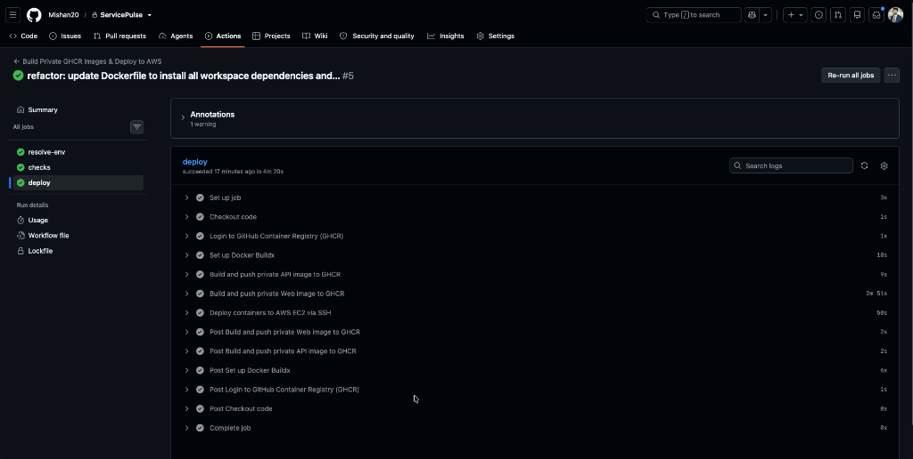
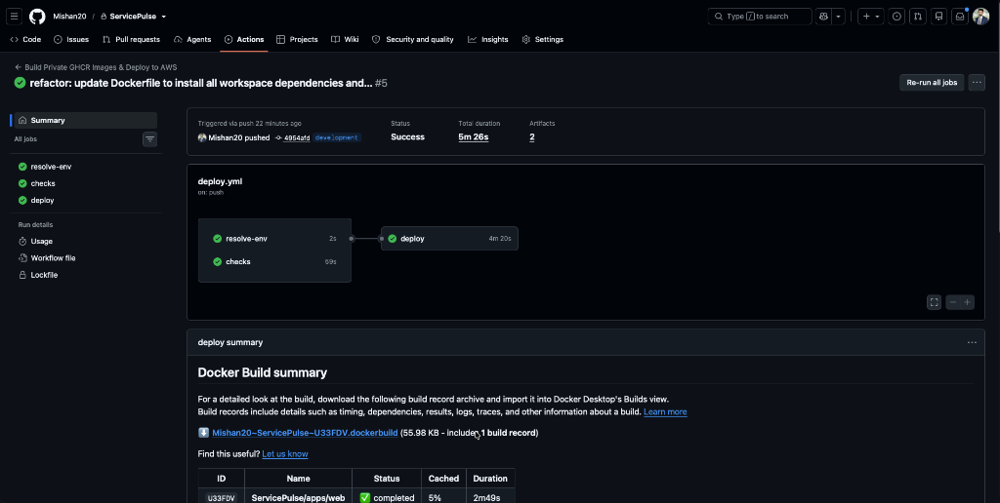
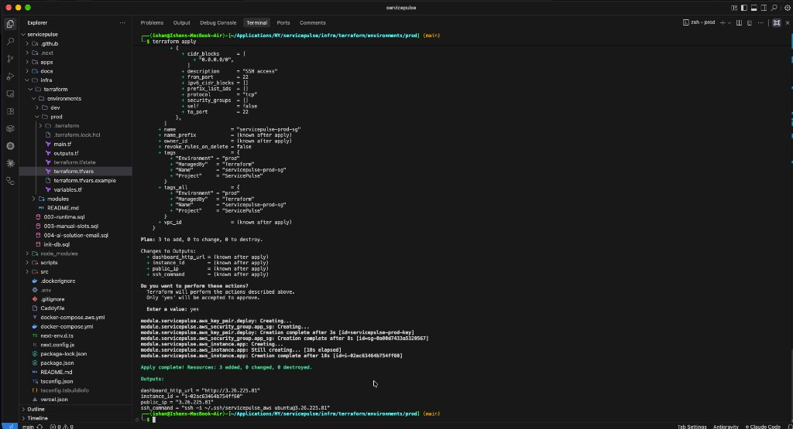
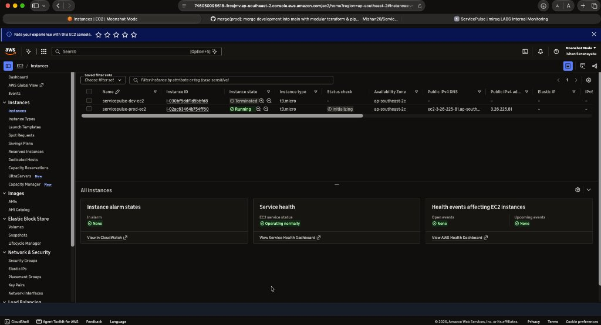
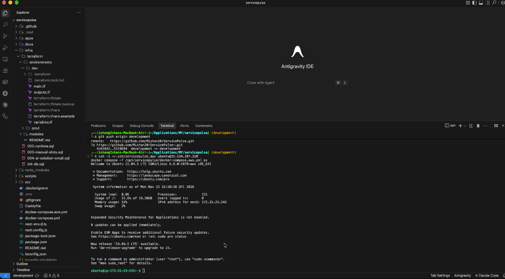
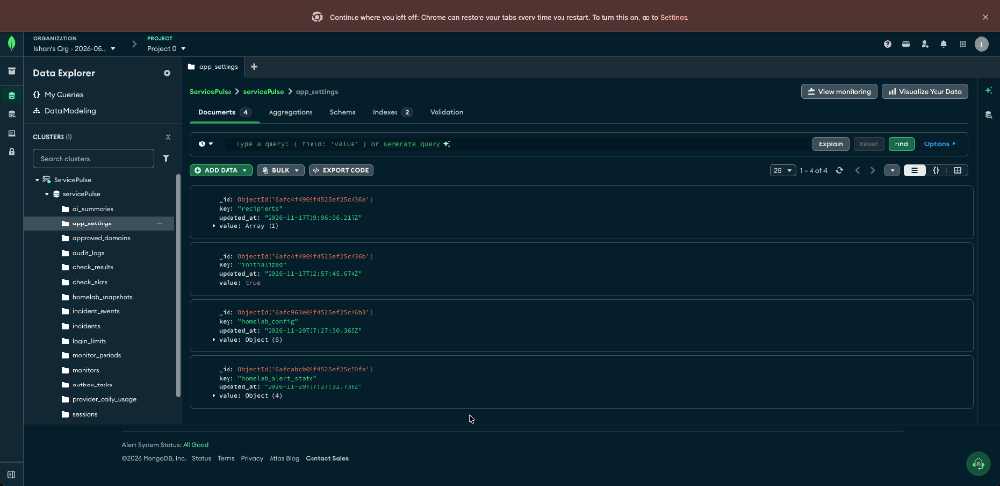
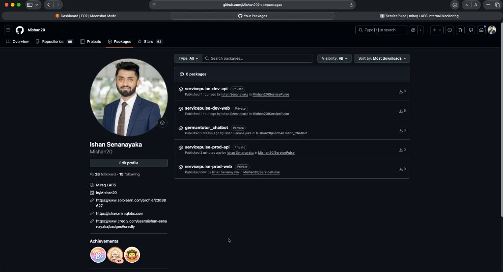
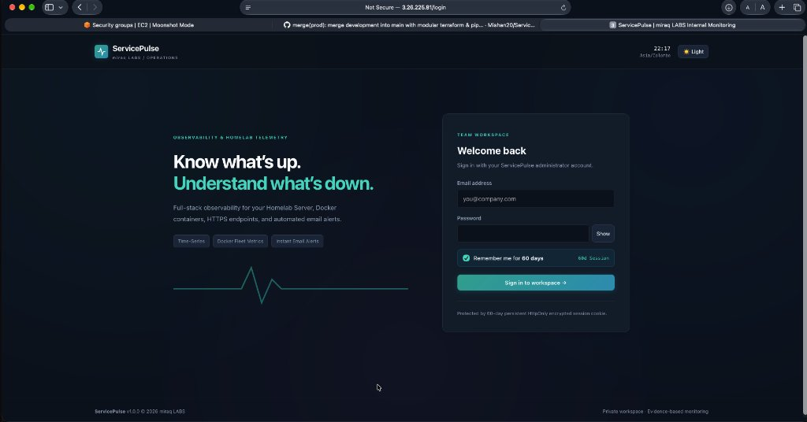

# ⚡ ServicePulse — Enterprise Observability Platform & Cloud DevOps Architecture

[](https://aws.amazon.com/)
[](https://www.terraform.io/)
[](https://www.docker.com/)
[](https://github.com/features/actions)
[-black?logo=github&logoColor=white)](https://ghcr.io)
[-00ADD8?logo=caddy&logoColor=white)](https://caddyserver.com/)
[](https://www.mongodb.com/atlas)

> **Architected, Containerized, and Provisioned by Ishan Senanayaka ([@Mishan20](https://github.com/Mishan20))**  
> *Note: This repository is a public architectural showcase and DevOps portfolio. The proprietary application source code is maintained in an internal enterprise repository.*

---

## 🎯 Executive Overview

**ServicePulse** is an internal, full-stack service monitoring and incident investigation platform designed for high-availability observability. It continuously audits HTTP/HTTPS endpoints, SSL certificate lifespans, latency deviations, Homelab hardware telemetry, and automated AI-driven incident resolution.

This repository serves as a **comprehensive DevOps & Cloud showcase**, demonstrating:
1. **Infrastructure as Code (IaC):** Multi-environment (`dev` & `prod`) automated provisioning using HashiCorp Terraform on AWS.
2. **Containerization & Multi-stage Builds:** Minimal Alpine-based Docker images with zero host overhead and secure runtime non-root users.
3. **Private Container Registry (GHCR):** Private OCI artifact storage with automatic deployment authentication.
4. **Automated CI/CD Pipeline:** Trunk-based branch promotion (`development` ➔ `dev`, `main` ➔ `prod`) with zero-downtime rolling SSH deployment.
5. **Cost Optimization:** Architected to run at near-zero idle cost on AWS Free Tier / sandbox environments while supporting clean, 1-click `terraform destroy` teardowns.

---

## 📐 Cloud & System Architecture

```text
                                         +--------------------------------------------+
                                         |           GitHub Ecosystem                 |
+-------------------+                    |                                            |
| Developer Machine | ── git push ─────> |  GitHub Repository (Trunk-based workflow)  |
+-------------------+                    |       │                                    |
                                         |       ▼                                    |
                                         |  GitHub Actions (CI/CD Matrix)             |
                                         |   ├─ Lint & Automated Test Checks          |
                                         |   ├─ Docker Multi-stage Buildx             |
                                         |   └─ Push to GitHub Container Registry     |
                                         |           │ (ghcr.io - Private Images)     |
                                         +───────────┼────────────────────────────────+
                                                     │
                                                     ▼ SSH Deploy via Deploy Keys
+────────────────────────────────────────────────────┼────────────────────────────────+
| AWS Cloud (ap-southeast-2 - Sydney)                │                                |
|                                                    ▼                                |
|  +───────────────────────────────────────────────────────────────────────────────+  |
|  | EC2 Instance (t3.micro + 20GB gp3 + 2GB Swapfile)                             |  |
|  |                                                                               |  |
|  |   [Ports: 80 (HTTP) & 443 (HTTPS)]                                            |  |
|  |                  │                                                            |  |
|  |                  ▼                                                            |  |
|  |   +─────────────────────────────+                                             |  |
|  |   |  Caddy Reverse Proxy        | ── (Automatic Let's Encrypt Free SSL/TLS)   |  |
|  |   +─────────────────────────────+                                             |  |
|  |                  │                                                            |  |
|  |                  ▼ (Internal Docker Bridge Network)                           |  |
|  |   +─────────────────────────────+       +─────────────────────────────+       |  |
|  |   |  ServicePulse Web (Next.js) |       |  ServicePulse API (Node.js) |       |  |
|  |   +─────────────────────────────+       +─────────────────────────────+       |  |
|  |                                                        │                      |  |
|  |                                                        ▼                      |  |
|  |                                         +─────────────────────────────+       |  |
|  |                                         |  Background Worker Engine   |       |  |
|  |                                         +─────────────────────────────+       |  |
|  +────────────────────────────────────────────────────────┼──────────────────────+  |
+───────────────────────────────────────────────────────────┼─────────────────────────+
                                                            │ MONGODB_URI (TLS)
                                                            ▼
                                             +─────────────────────────────+
                                             |  MongoDB Atlas Cluster      |
                                             |  (Cloud Managed DB)         |
                                             +─────────────────────────────+
```

---

## 📸 Production Verification & Showcase Proof

### 1. Fully Automated CI/CD Pipeline (GitHub Actions)
Continuous Integration verifies TypeScript compilation, runs unit & smoke test suites, builds optimized multi-stage Docker images, pushes to GHCR, and performs automated rolling SSH deployment to AWS EC2 with instant health checks.


*Figure 1: GitHub Actions deploying production image to AWS EC2 in under 5 minutes with complete build provenance.*

---

### 2. Private Container Registry (GitHub Packages — GHCR)
All production and development container artifacts are privately published and versioned with Git SHAs and `:latest` tags under strict organizational access control.


*Figure 2: Authenticated, private OCI Docker images stored securely in GitHub Packages.*

---

### 3. Infrastructure as Code (HashiCorp Terraform)
Modular Terraform infrastructure defines security groups, SSH key pairs, storage volumes, and compute nodes per environment with zero manual configuration.


*Figure 3: Automated provisioning of AWS infrastructure with zero drifted state and clean destroy capability.*

---

### 4. AWS Cloud Production Infrastructure
The application runs on AWS EC2 instances governed by strict Least Privilege security groups exposing only reverse proxy and management ingress ports.


*Figure 4: Active production compute instance running in `ap-southeast-2` alongside clean termination of legacy staging instances.*

---

### 5. Multi-Container Orchestration (Docker & Caddy)
The production host runs isolated containers communicating over a secure internal Docker bridge network, protected by a Caddy HTTP/HTTPS reverse proxy with automatic TLS certificate renewals.


*Figure 5: Live server terminal showing healthy containers, automated swap memory utilization, and zero host bloat.*

---

### 6. Cloud Database Integration (MongoDB Atlas)
Decoupled cloud database architecture utilizing MongoDB Atlas with network IP whitelisting and structured operational telemetry collections.


*Figure 6: Live application settings, snapshot records, and heartbeat monitoring stored on cloud MongoDB cluster.*

---

### 7. Live Production Dashboard & Homelab Observability
Interactive, real-time observability suite featuring time-series response charts, container fleet health, server load, and CPU thermal gauges.


*Figure 7: Live ServicePulse operational telemetry monitoring server saturation and response metrics.*


*Figure 8: Secure workspace login protected by HTTP-only persistent encrypted session cookies.*

---

## 🛠️ Key Technical Implementations

| Capability | Technology / Architecture | Description |
|---|---|---|
| **IaC** | Terraform `>= 1.5.0` | Modular environment management (`dev`, `prod`), Canonical Ubuntu AMI lookup, and single-command teardown (`terraform destroy`). |
| **Containerization** | Docker Engine & Compose | Multi-stage Node 22 Alpine builds, non-root user execution, and custom health check probes. |
| **Edge & Security** | Caddy v2 Reverse Proxy | Automatic Let's Encrypt TLS/SSL termination, reverse proxy routing, and HTTP/2 gzip compression. |
| **Registry** | GitHub Packages (GHCR) | Private image repository replacing vendor-locked cloud registries, reducing cloud egress and storage bills. |
| **CI/CD** | GitHub Actions | Automated trigger on push to `development` (staging) and `main` (production), SSH heredoc key injection, and automated image pruning. |
| **Database** | MongoDB Atlas | Decoupled managed database cluster, eliminating local container database state loss. |

---

## 👤 Author & Contact

**Ishan Senanayaka**  
- **GitHub:** [@Mishan20](https://github.com/Mishan20)  
- **LinkedIn:** [linkedin.com/in/Mishan20](https://linkedin.com/in/Mishan20)  
- **Portfolio:** [ishan.miraqlabs.com](https://ishan.miraqlabs.com)  

---
*Distributed under the MIT License for infrastructure architecture. ServicePulse UI & Design © 2026 miraq LABS.*
